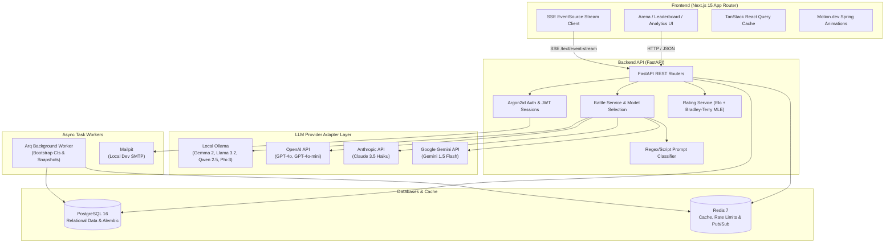

# ModelArena ⚔️
**Blind LLM Comparison Platform with Online Elo & Bradley-Terry Leaderboard**

ModelArena is a production-grade, open-source platform for crowdsourced, blind evaluation of Large Language Models. Users submit prompts to receive anonymous, side-by-side responses. They cast their vote, triggering an animated reveal of model identities, while live votes update an online Elo and Bradley-Terry ranking engine with non-parametric bootstrap confidence intervals.

---

## Architecture Diagram



---

## Key Features

1. **Blind Head-to-Head Testing:**
   - Both models generate responses simultaneously.
   - Strict anti-leak guarantee: zero model metadata, tokens, or headers exposed to the client prior to voting.
2. **Streaming Generation:**
   - Real-time Server-Sent Events (SSE) streaming with TTFT, latency, and token cost measurement.
3. **Rigorous Statistical Ranking:**
   - **Online Elo (K=32):** Instantaneous ranking updates after each vote.
   - **Bradley-Terry MLE:** Logistic regression model fit across all decisive and tie votes.
   - **Bootstrap Confidence Intervals:** 95% non-parametric bootstrap resampling (200–1000 iterations).
   - **Confidence-Aware Ranking:** Models ranked by statistical bounds; provisional badge for <20 battles.
4. **Rich Analytics & Dashboards:**
   - Dot-and-whisker confidence interval chart.
   - Pairwise win-fraction heatmap matrix.
   - Quality vs. cost scatter plots.
   - Rating progression trends over time.
5. **Modern Tech Stack:**
   - Next.js 15, TypeScript (strict mode), Tailwind CSS, shadcn/ui, `motion/react`, Recharts, TanStack Query.
   - FastAPI (Python 3.12), SQLAlchemy 2.0 (async), asyncpg, Alembic, Pydantic v2, Redis 7.

---

## Quickstart (Single Command)

To run the entire system with Docker Compose:

```bash
docker compose up --build
```

This starts:
- **Frontend:** [http://localhost:3000](http://localhost:3000)
- **Backend API Docs:** [http://localhost:8000/docs](http://localhost:8000/docs)
- **Backend Health Check:** [http://localhost:8000/api/health](http://localhost:8000/api/health)
- **Mailpit Web UI (Dev SMTP):** [http://localhost:8025](http://localhost:8025)
- **PostgreSQL:** Port 5432
- **Redis:** Port 6379
- **Ollama:** Port 11434

---

## Environment Variables (`.env`)

Copy `.env.example` to `.env`:

```bash
cp .env.example .env
```

| Variable | Description | Default |
|---|---|---|
| `POSTGRES_HOST` | Postgres host | `db` |
| `POSTGRES_DB` | Database name | `modelarena` |
| `POSTGRES_USER` | Database user | `modelarena` |
| `POSTGRES_PASSWORD` | Database password | `changeme_in_production` |
| `REDIS_URL` | Redis connection URL | `redis://redis:6379/0` |
| `SECRET_KEY` | JWT signing secret | 64-char random string |
| `OLLAMA_BASE_URL` | Ollama service endpoint | `http://ollama:11434` |
| `OPENAI_API_KEY` | Optional: OpenAI API Key | `""` |
| `ANTHROPIC_API_KEY` | Optional: Anthropic API Key | `""` |
| `GOOGLE_API_KEY` | Optional: Gemini API Key | `""` |
| `SMTP_HOST` | Dev SMTP server | `mailpit` |
| `SMTP_PORT` | Dev SMTP port | `1025` |

---

## Seeding Models & Simulating Votes

Inside the Docker backend container (or locally in `backend/`):

### 1. Seed the Model Registry
```bash
docker compose exec backend python -m scripts.seed_models
```

### 2. Generate Simulated Demo Battles & Compute Leaderboard
```bash
docker compose exec backend python -m scripts.simulate_votes
```
*Note: All simulated records are flagged with `is_simulated = true`. The UI provides a toggle to include or exclude simulated demo data at any time.*

---

## Running Backend Tests

Run pytest inside the backend container or locally:

```bash
docker compose exec backend pytest
```

Included tests:
- `tests/test_rating_math.py`: Validates hand-computed Elo, Bradley-Terry MLE ranking recovery, and Bootstrap CIs.
- `tests/test_anti_leak.py`: Verifies that model identities and parameters never leak before voting.

---

## Adding a New Model or Provider

### Adding a Model
Insert a new row in the `models` table via `scripts/seed_models.py` or the Admin API:
```python
{
    "slug": "mistral-7b-instruct",
    "display_name": "Mistral 7B Instruct",
    "provider": "ollama",
    "provider_model_id": "mistral:7b-instruct",
    "input_price_per_mtok": Decimal("0.0"),
    "output_price_per_mtok": Decimal("0.0"),
    "is_open_source": True,
    "is_enabled": True,
}
```

### Adding a New Provider Adapter
1. Inherit from `LLMProvider` in `backend/app/services/providers/base.py`.
2. Implement `stream_completion(provider_model_id, prompt)` and `count_tokens(text)`.
3. Register the provider in `backend/app/services/provider_registry.py`.

---

## Known Limitations & Considerations
- **Cold-Start Models:** Models with fewer than 20 battles are marked as **Provisional** to account for high statistical variance.
- **Local Ollama Model Pulling:** First-time container startup pulls Ollama models over the network. If bandwidth is constrained, allow a few extra minutes for the `ollama-pull` service to finish downloading images.

