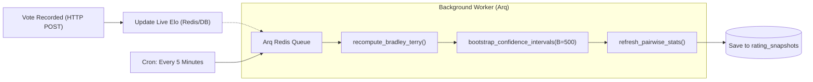

# Multi-Agent Architecture & Background Tasks — ModelArena

## 1. Overview

**ModelArena** employs an asynchronous multi-agent coordination architecture combining native IDE subagents for system operations with an **Arq Redis worker** managing background data processing, rating recalculations, and statistical simulations.

---

## 2. Specialized System Agents

The following subagents coordinate maintenance, feature additions, debugging, and verification:

| Agent Name | Role | Primary Responsibility |
| :--- | :--- | :--- |
| `backend-builder` | Backend API Builder | Manages FastAPI endpoints, provider adapters, rating mathematics, and Alembic migrations. |
| `frontend-builder` | Frontend UI Builder | Constructs Next.js 15 App Router views, Motion animations, Recharts, and Tailwind components. |
| `gsd-debugger` | Hypothesis-Driven Debugger | Investigates Docker container networking, CORS, SQL foreign key constraints, and model timeouts. |
| `gsd-executor` | Plan Executor | Executes systematic task milestones with atomic per-task commits and deviation protocols. |
| `gsd-verifier` | Empirical Verifier | Tests live endpoints, verifies anti-leak compliance, and confirms zero mocks. |

---

## 3. Background Worker Jobs (`backend/app/workers/`)

The background worker runs via **Arq** connected to Redis 7 (`redis://redis:6379/0`):



### 3.1. `recompute_ratings_task`
- **Schedule:** Triggered every 5 minutes and on-demand via the admin endpoint (`POST /api/admin/recompute-ratings`).
- **Function:** Aggregates decisive votes (`choice == 'A'` or `'B'`) and ties (treated as 0.5 win each). Excludes `both_bad` and votes flagged as suspicious.
- **Algorithm:** Fits Bradley-Terry logit weights using `scikit-learn` LogisticRegression.

### 3.2. `bootstrap_ci_task`
- **Execution:** Runs $B = 500$ bootstrap iterations.
- **Sampling:** Resamples decisive battle records with replacement.
- **Output:** Computes 2.5th and 97.5th percentiles per model, storing `ci_low` and `ci_high` in `rating_snapshots`.

### 3.3. `refresh_pairwise_stats_task`
- **Function:** Materializes pairwise comparison tallies ($A$ wins, $B$ wins, ties) across each category and overall.

---

## 4. Model Selection & Pairing Agent

Inside [backend/app/services/battle_service.py](file:///c:/Users/vinee/project%201/modelarena/backend/app/services/battle_service.py), the `select_model_pair` agent executes inverse-frequency sampling:
```python
# Inverse-frequency weights: under-sampled models get higher selection weights
max_count = max(battle_counts.values()) if battle_counts else 1
weights = [max_count - battle_counts.get(m.id, 0) + 1 for m in models]
```
- **Fair Exploration:** Ensures newly added models (such as `gemini-flash` or `gpt-4o`) are immediately selected in high frequency to rapidly converge their Elo and Bradley-Terry confidence intervals.
- **Slot Inversion:** Randomizes assignments between Slot A and Slot B using a 50/50 Bernoulli trial to eliminate UI position bias.

