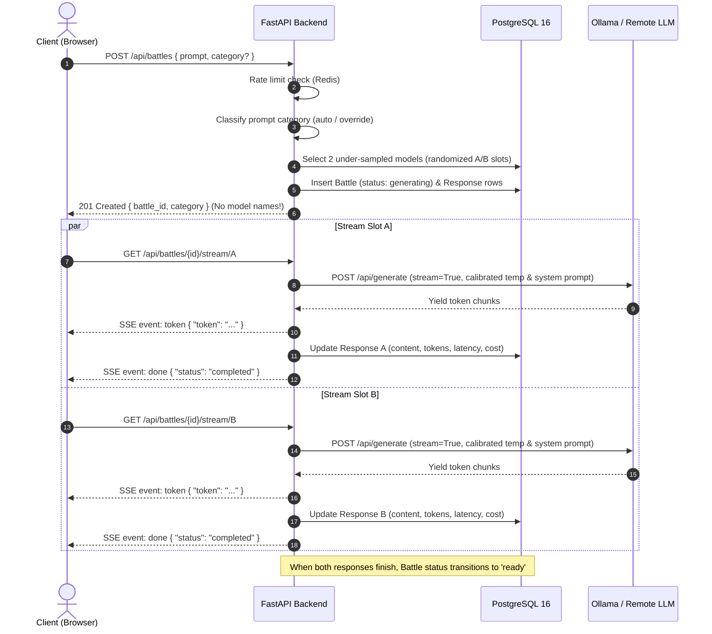
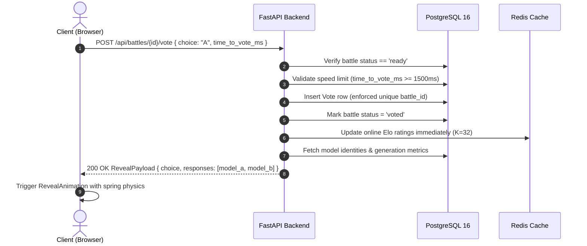

# System Architecture Specification — ModelArena

## 1. System Overview

**ModelArena** is architected as an asynchronous, event-driven full-stack platform consisting of seven interconnected containerized services managed via Docker Compose:

```mermaid
flowchart TD
    User["Web Browser Client (Next.js 15)"]
    
    subgraph "Docker Compose Network (modelarena-network)"
        FE["Frontend (Next.js 15 App Router)<br/>Port 3000"]
        BE["Backend API (FastAPI / Python 3.12)<br/>Port 8000"]
        WK["Async Background Worker (Arq)<br/>Redis Tasks"]
        DB[("PostgreSQL 16 (Relational DB)<br/>Port 5432")]
        RD[("Redis 7 (Cache, Queue, Rate Limits)<br/>Port 6379")]
        OL["Ollama Service (Local LLMs)<br/>Port 11434"]
        MP["Mailpit (Dev SMTP Server)<br/>Port 1025 / 8025"]
    end
    
    subgraph "External Cloud LLM Providers"
        OAI["OpenAI / Groq API"]
        ANT["Anthropic Claude API"]
        GEM["Google Gemini API"]
    end

    User -->|HTTP / SSE| FE
    FE -->|Client-side Fetch / SSE| BE
    BE -->|Async SQL (SQLAlchemy + asyncpg)| DB
    BE -->|Async Cache / Sliding Rate Limit| RD
    BE -->|Local Model Inference| OL
    BE -->|Remote Model Inference| OAI
    BE -->|Remote Model Inference| ANT
    BE -->|Remote Model Inference| GEM
    BE -->|Transactional Emails| MP
    WK -->|Rating Recompute / Bootstrap CI| DB
    WK -->|Job Queues| RD
```

---

## 2. Core Service Components

### 2.1. Frontend (`frontend/`)
- **Framework:** Next.js 15 (App Router), React 19, TypeScript strict mode.
- **Styling & Components:** Tailwind CSS, shadcn/ui components, Lucide icons.
- **Animations:** Motion (`motion/react`).
- **Data & State Management:** TanStack React Query v5 for server state, native browser `EventSource` for SSE streaming.
- **Charts:** Recharts (responsive scatter plots, heatmaps, rating trend lines).

### 2.2. Backend API (`backend/`)
- **Framework:** FastAPI with Python 3.12 and Uvicorn.
- **Persistence Layer:** SQLAlchemy 2.0 async ORM paired with `asyncpg`.
- **Database Migrations:** Alembic (strictly migration-driven, zero `create_all()` in production).
- **Streaming:** Server-Sent Events (SSE) via `sse-starlette`.
- **Validation:** Pydantic v2 schemas for all requests, responses, and settings.
- **Structured Logging:** `structlog` formatting JSON logs with correlation IDs.

### 2.3. Asynchronous Worker (`backend/app/workers/`)
- **Queue System:** Arq (Redis-backed asynchronous job queue).
- **Scheduled Tasks:** Periodic rating recomputation, Bradley-Terry MLE refitting, and 500-iteration bootstrap confidence interval simulations.

### 2.4. LLM Provider Adapter Layer (`backend/app/services/providers/`)
Standardized `LLMProvider` interface implementing:
- `OllamaProvider`: Local models (`qwen2.5:3b`, `llama3.2:3b`, `phi3:mini`, `gemma2:2b`).
- `OpenAIProvider`: Remote models with auto-routing for standard OpenAI (`sk-`) and Groq high-speed inference (`gsk_`).
- `AnthropicProvider`: Anthropic Claude messages API.
- `GeminiProvider`: Google Gemini generateContent & streamGenerateContent API.

---

## 3. Data Flow Diagrams

### 3.1. Battle Creation & Dual Concurrent Streaming



### 3.2. Voting & Reveal Flow



---

## 4. Rating Mathematics & Statistical Pipeline

### 4.1. Online Elo Calculation
Updated immediately on vote submission:
$$\mu_A = \frac{1}{1 + 10^{(R_B - R_A)/400}}$$
$$R'_A = R_A + K \cdot (S_A - \mu_A)$$
- $K = 32$, initial rating $R_0 = 1000$.
- $S_A = 1.0$ (win), $0.5$ (tie), $0.0$ (loss).
- `both_bad` votes are logged for abuse tracking but excluded from Elo updates.

### 4.2. Bradley-Terry Maximum Likelihood Estimation (MLE)
The probability that Model $i$ beats Model $j$:
$$P(i \succ j) = \frac{\pi_i}{\pi_i + \pi_j} = \frac{1}{1 + e^{-(\beta_i - \beta_j)}}$$
Fitted using Logistic Regression with no intercept and scaled to an Elo-equivalent distribution:
$$R_i = \beta_i \times \frac{400}{\ln(10)} + 1000$$

### 4.3. Bootstrap Confidence Intervals
1. Resample historical battle outcomes $B = 500$ times with replacement.
2. Refit the Bradley-Terry logistic regression on each sample.
3. Compute the 2.5th and 97.5th percentiles per model to yield the 95% confidence interval $[CI_{low}, CI_{high}]$.

