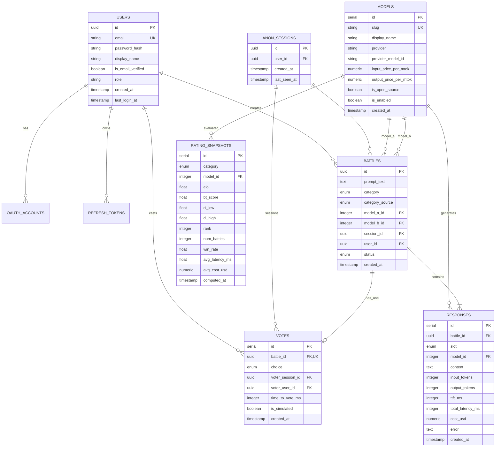

# Database Schema & Data Architecture — ModelArena

## 1. Overview

**ModelArena** uses **PostgreSQL 16** with asynchronous I/O via `asyncpg` and SQLAlchemy 2.0 ORM. All schema modifications are tracked and executed using **Alembic** migrations.

---

## 2. Entity-Relationship Diagram (ERD)



---

## 3. Table Definitions & Constraints

### 3.1. `users`
Represents registered platform accounts.
- `id` (UUID, Primary Key, default `gen_random_uuid()`)
- `email` (VARCHAR(255), Unique, Indexed)
- `password_hash` (VARCHAR(255), Nullable for OAuth accounts)
- `display_name` (VARCHAR(100), NOT NULL)
- `is_email_verified` (BOOLEAN, default `False`)
- `role` (VARCHAR(20), default `'user'`)
- `created_at` (TIMESTAMPTZ, default `now()`)
- `last_login_at` (TIMESTAMPTZ, Nullable)

### 3.2. `anon_sessions`
Tracks anonymous visitor sessions via long-lived HTTP-only cookies.
- `id` (UUID, Primary Key)
- `user_id` (UUID, Foreign Key `users.id`, Nullable — linked upon login)
- `created_at` (TIMESTAMPTZ, default `now()`)
- `last_seen_at` (TIMESTAMPTZ, default `now()`)

### 3.3. `models`
Registry of available LLMs, pricing, and provider endpoints.
- `id` (INTEGER, Primary Key, Auto-increment)
- `slug` (VARCHAR(100), Unique, Indexed)
- `display_name` (VARCHAR(150), NOT NULL)
- `provider` (VARCHAR(50), NOT NULL — `ollama`, `openai`, `gemini`, `anthropic`)
- `provider_model_id` (VARCHAR(150), NOT NULL — e.g. `llama3.2:3b`, `gemini-3.5-flash`)
- `input_price_per_mtok` (NUMERIC(10, 4), default 0.0)
- `output_price_per_mtok` (NUMERIC(10, 4), default 0.0)
- `is_open_source` (BOOLEAN, default `True`)
- `is_enabled` (BOOLEAN, default `True`)
- `created_at` (TIMESTAMPTZ, default `now()`)

### 3.4. `battles`
Records blind head-to-head comparison events.
- `id` (UUID, Primary Key, default `gen_random_uuid()`)
- `prompt_text` (TEXT, NOT NULL, max 4,000 characters)
- `category` (ENUM: `general`, `coding`, `math`, `hindi`, `summarization`)
- `category_source` (ENUM: `auto`, `user`)
- `model_a_id` (INTEGER, Foreign Key `models.id`, NOT NULL)
- `model_b_id` (INTEGER, Foreign Key `models.id`, NOT NULL)
- `session_id` (UUID, Foreign Key `anon_sessions.id`, NOT NULL)
- `user_id` (UUID, Foreign Key `users.id`, Nullable)
- `status` (ENUM: `generating`, `ready`, `voted`, `failed`)
- `created_at` (TIMESTAMPTZ, default `now()`)
- **Check Constraint:** `CHECK (model_a_id != model_b_id)`
- **Indexes:** `idx_battles_category_created (category, created_at)`

### 3.5. `responses`
Generated text and telemetry per slot.
- `id` (INTEGER, Primary Key, Auto-increment)
- `battle_id` (UUID, Foreign Key `battles.id`, NOT NULL)
- `slot` (ENUM: `A`, `B`)
- `model_id` (INTEGER, Foreign Key `models.id`, NOT NULL)
- `content` (TEXT, NOT NULL, default `""`)
- `input_tokens` (INTEGER, default 0)
- `output_tokens` (INTEGER, default 0)
- `ttft_ms` (INTEGER, Nullable)
- `total_latency_ms` (INTEGER, Nullable)
- `cost_usd` (NUMERIC(12, 8), default 0.0)
- `error` (TEXT, Nullable)
- `created_at` (TIMESTAMPTZ, default `now()`)
- **Unique Constraint:** `UNIQUE (battle_id, slot)`
- **Index:** `idx_responses_model_id (model_id)`

### 3.6. `votes`
Records user decisions.
- `id` (INTEGER, Primary Key, Auto-increment)
- `battle_id` (UUID, Foreign Key `battles.id`, Unique Constraint `uq_votes_battle_id`)
- `choice` (ENUM: `A`, `B`, `tie`, `both_bad`)
- `voter_session_id` (UUID, Foreign Key `anon_sessions.id`, NOT NULL)
- `voter_user_id` (UUID, Foreign Key `users.id`, Nullable)
- `time_to_vote_ms` (INTEGER, Nullable)
- `is_simulated` (BOOLEAN, default `False`)
- `created_at` (TIMESTAMPTZ, default `now()`)
- **Index:** `idx_votes_created (created_at)`

### 3.7. `rating_snapshots`
Cached Bradley-Terry and Elo snapshots for the leaderboard.
- `id` (INTEGER, Primary Key, Auto-increment)
- `category` (ENUM, Nullable — NULL represents Overall leaderboard)
- `model_id` (INTEGER, Foreign Key `models.id`, NOT NULL)
- `elo` (DOUBLE PRECISION, NOT NULL)
- `bt_score` (DOUBLE PRECISION, NOT NULL)
- `ci_low` (DOUBLE PRECISION, NOT NULL)
- `ci_high` (DOUBLE PRECISION, NOT NULL)
- `rank` (INTEGER, NOT NULL)
- `num_battles` (INTEGER, NOT NULL)
- `win_rate` (DOUBLE PRECISION, NOT NULL)
- `avg_latency_ms` (DOUBLE PRECISION, NOT NULL)
- `avg_cost_usd` (NUMERIC(12, 8), NOT NULL)
- `computed_at` (TIMESTAMPTZ, default `now()`)
- **Index:** `idx_snapshots_category_computed (category, computed_at DESC)`

---

## 4. Alembic Migration Strategy

All schema changes reside under `backend/alembic/versions/`. Migrations execute on startup before the API accepts incoming HTTP traffic:
```bash
alembic upgrade head
```
Rollbacks and version checks:
```bash
alembic current
alembic history --verbose
```

